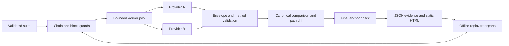

# RPC Crucible

Two RPC providers can answer the same request differently. Before treating that as a bug, check that they are answering for the same chain and block.

RPC Crucible is a small developer harness for that investigation. It compares a bounded set of Ethereum JSON-RPC reads, keeps the evidence, and replays the run without network access.

**Status:** early independent implementation. Six read-only methods. Synthetic demo. Tested on Node 24.19.0. No production-provider benchmark claims.

## Run the demo

Requires **Node 24 or newer**. There are no dependencies to install.

```sh
npm test
node cli.mjs demo --out demo
# Open demo.html; inspect demo.json for the full evidence.
node cli.mjs replay --input demo.json --out replay
```

The demo intentionally produces two matches, one divergent balance, one invalid quantity and one matching RPC error. These are fabricated fixtures, not observations about any provider. Replay exits with status 1 because that evidence includes unsuccessful cases.

Output files are created exclusively: choose a new `--out` prefix for each run.

## What it checks

- Chain identity and pinned block hash before comparison.
- The block hash again after reads, to detect a reorg or unstable provider.
- JSON-RPC version, request ID, result/error exclusivity and error structure.
- Minimal hexadecimal quantities, complete byte strings and storage word length.
- Selected block fields: number, hash, parent hash and transaction hashes.
- Path-level differences, preserving exact hex integers and array order.
- Bounded concurrency, transport timeouts, response-size limits and retry budgets.
- Replay from captured requests/responses with no endpoint access.

Methods: `eth_chainId`, `eth_getBalance`, `eth_getTransactionCount`, `eth_getCode`, `eth_getStorageAt`, `eth_getBlockByNumber`.

## Compare endpoints you operate or have permission to use

Create a suite using a fixed block number:

```json
{
  "version": 1,
  "block": "0x1234",
  "cases": [
    {
      "name": "account-code",
      "method": "eth_getCode",
      "params": ["0x1111111111111111111111111111111111111111", "0x1234"]
    }
  ]
}
```

The address and block above are placeholders. Select a block both endpoints retain.

Put endpoint URLs in environment variables `RPC_A` and `RPC_B`, then run:

```sh
node cli.mjs run --suite suite.json --left-env RPC_A --right-env RPC_B --concurrency 2 --out comparison
```

Remote endpoints must use HTTPS. Loopback HTTP is allowed for local nodes. Redirects are rejected. No signing, transaction submission, wallet access or endpoint discovery.

For N cases, a successful run makes N+3 calls **per endpoint**: chain identity, initial block anchor, N reads, final anchor. The default transport allows one retry per call. Concurrency is per endpoint and capped at eight.

## Read the result

| Outcome | Meaning |
| --- | --- |
| `match` | Valid responses agree under documented comparison rules |
| `divergent` | Responses disagree; neither is automatically considered correct |
| `invalid` | At least one response failed a covered validation rule |
| `matching-error` | Providers returned matching error code/data; no successful read |
| `transport-error` | A request failed before a usable RPC response |

When anchor verification fails, the entire run is inconclusive, even if individual case rows appear to match. Equal error codes do not establish equivalent underlying causes.

CLI exit codes: **0** all compared cases match (or demo command); **1** comparison failure/inconclusive result; **2** input, configuration or output error.

## Architecture



`core.mjs` owns validation, comparison and scheduling. `transport.mjs` owns HTTP and retry policy. `report.mjs` renders escaped, script-free HTML. `demo.mjs` is the deterministic fault fixture. `cli.mjs` handles local files and environment configuration.

## Limits worth understanding

This is **partial validation**, not a full execution-API conformance checker, consensus client, transaction simulator or proof of correct state. Block objects are checked only for the fields listed above. Unexpected extra fields participate in comparison but are not fully schema-validated.

Hexadecimal case and object-key order are ignored. Array order matters. Error prose is retained in JSON evidence but ignored for equality; error codes and data are compared. Diffs are capped at 50 entries. Input and response JSON are capped at 1 MiB, 32 levels and 20,000 structural nodes.

Fixed block numbers plus before/after hash checks reduce false comparisons, but cannot prove an endpoint answered every intermediate request against that anchor. EIP-1898 block-hash queries are a future extension.

The parser uses `JSON.parse`: duplicate JSON keys are not detected. Transport tests use controlled fetch responses; no live provider compatibility claim is made. Backoff is deterministic and bounded; `Retry-After` and global request-rate budgets are not implemented.

Endpoint configuration is excluded from reports, and local transport exception prose is suppressed. **Raw provider responses and queried addresses remain in JSON evidence.** A server could echo sensitive material. Review or redact real reports before sharing.

## Research and scope

The [Ethereum execution API specifications](https://github.com/ethereum/execution-apis) define the wider RPC surface. [Hive](https://github.com/ethereum/hive) provides Ethereum client end-to-end testing. [Foundry](https://github.com/foundry-rs/foundry) supplies a broader development toolkit. RPC Crucible explores a smaller workflow: inspect a pair of endpoints and share reproducible evidence from a dependency-free Node program.

Protocol reference: [JSON-RPC 2.0](https://www.jsonrpc.org/specification). The implementation and fixtures here are original; no affiliation or upstream endorsement is implied.

## Contributing

Bring a minimal synthetic fixture, expected result and relevant specification link. Useful next work includes EIP-1898 support, a versioned method-schema registry and multi-client integration tests. See [SECURITY.md](SECURITY.md) for trust boundaries.

MIT © 2026 Shelby
